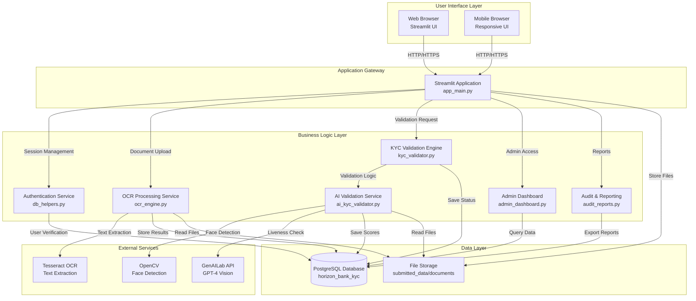
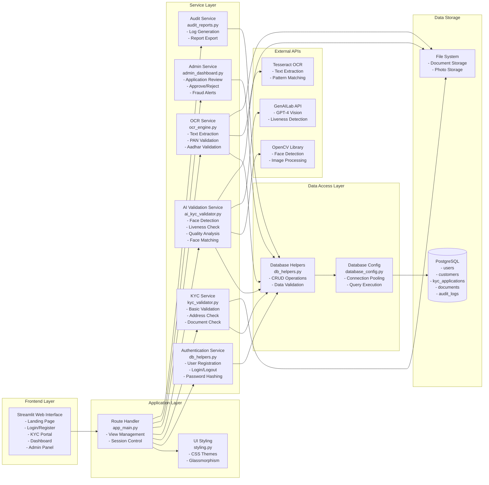
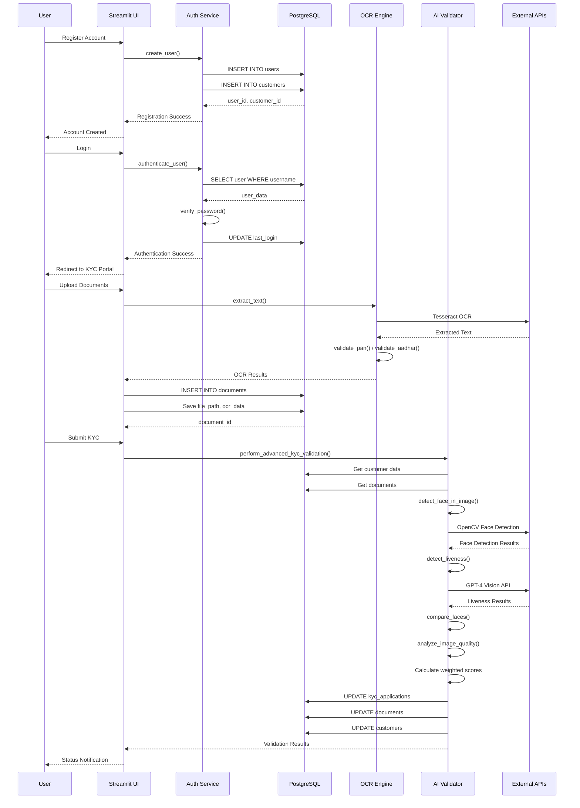
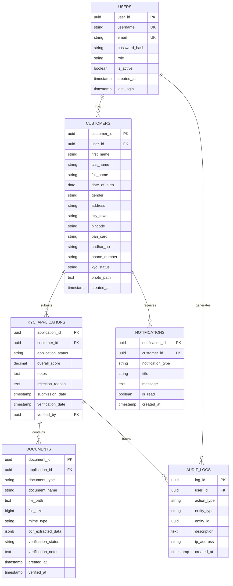
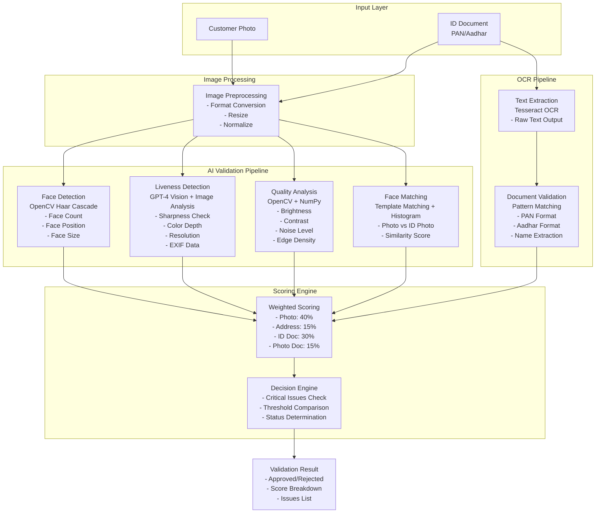
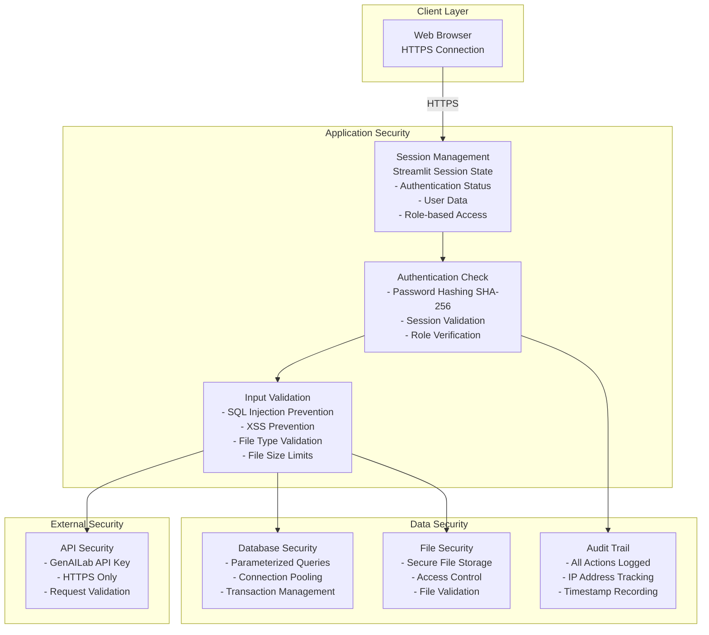
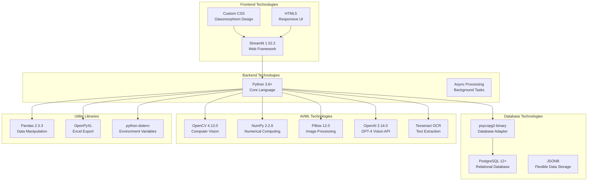

# 🏗️ Ti Tans Bank KYC System - Architecture Diagrams

## System Architecture Overview

This document provides comprehensive architecture diagrams for the Ti Tans Bank KYC Portal system, showing component interactions, data flow, and technology stack.

---

## 📊 High-Level System Architecture



---

## 🎯 Component Architecture Diagram



---

## 🔄 Data Flow Architecture



---

## 🗄️ Database Architecture



---

## 🤖 AI/ML Processing Architecture



---

## 🔐 Security Architecture



---

## 📦 Technology Stack Architecture



---

## 🎯 Component Descriptions

### 1. **User Interface Layer**

#### Web Browser (Streamlit UI)
- **Technology**: Streamlit 1.52.2
- **Purpose**: Provides web-based user interface for all system interactions
- **Features**:
  - Responsive design for desktop and mobile browsers
  - Glassmorphism UI with custom CSS styling
  - Page-specific color schemes
  - Real-time status updates
- **Components**:
  - Landing Page
  - Login/Registration Forms
  - KYC Portal (Document Upload)
  - Customer Dashboard
  - Admin Dashboard
  - Status Check Page

---

### 2. **Application Gateway**

#### Streamlit Application (app_main.py)
- **Technology**: Python, Streamlit
- **Purpose**: Main application entry point and routing controller
- **Responsibilities**:
  - View/page routing and navigation
  - Session state management
  - User authentication flow
  - Request handling and response generation
  - Error handling and user feedback
- **Key Functions**:
  - `change_view()`: Navigate between pages
  - `handle_webcam_capture()`: Camera integration
  - `_display_application_details()`: Status display

---

### 3. **Business Logic Layer**

#### Authentication Service (db_helpers.py)
- **Technology**: Python, SHA-256 hashing
- **Purpose**: User authentication and authorization
- **Features**:
  - User registration with duplicate prevention
  - Password hashing (SHA-256)
  - Session management
  - Role-based access control (customer/admin)
- **Key Functions**:
  - `create_user()`: Register new user
  - `authenticate_user()`: Login validation
  - `hash_password()`: Secure password storage

#### KYC Validation Service (kyc_validator.py)
- **Technology**: Python, Image Processing
- **Purpose**: Basic KYC validation logic
- **Features**:
  - Photo validation (dimensions, file size)
  - Address validation (completeness, OCR matching)
  - Document validation (presence, verification status)
  - Weighted scoring calculation
- **Key Functions**:
  - `validate_photo()`: Photo quality checks
  - `validate_address()`: Address validation
  - `perform_kyc_validation()`: Overall validation

#### AI Validation Service (ai_kyc_validator.py)
- **Technology**: OpenCV, GPT-4 Vision, NumPy
- **Purpose**: Advanced AI-powered validation
- **Features**:
  - Face detection using OpenCV Haar Cascade
  - Liveness detection via GPT-4 Vision API
  - Image quality analysis (brightness, contrast, noise)
  - Face matching between photo and ID document
  - Document type detection (PAN vs Aadhar)
- **Key Functions**:
  - `detect_face_in_image()`: Face detection
  - `detect_liveness()`: Liveness verification
  - `compare_faces()`: Face matching
  - `perform_advanced_kyc_validation()`: Complete AI validation

#### OCR Processing Service (ocr_engine.py)
- **Technology**: Tesseract OCR, Python Regex
- **Purpose**: Text extraction and document validation
- **Features**:
  - Text extraction from images (PAN, Aadhar)
  - Pattern matching for document formats
  - Field extraction (name, DOB, ID numbers)
  - Completeness scoring
- **Key Functions**:
  - `extract_text_from_image()`: OCR text extraction
  - `validate_pan()`: PAN card validation
  - `validate_aadhar()`: Aadhar card validation

#### Admin Dashboard Service (admin_dashboard.py)
- **Technology**: Python, Streamlit
- **Purpose**: Administrative functions and customer management
- **Features**:
  - Pending application review
  - Manual approve/reject actions
  - Fraud alert monitoring
  - System health metrics
  - Application details view
- **Key Functions**:
  - `get_pending_applications()`: Fetch pending apps
  - `admin_approve_kyc()`: Manual approval
  - `admin_reject_kyc()`: Manual rejection

#### Audit & Reporting Service (audit_reports.py)
- **Technology**: Python, Pandas, OpenPyXL
- **Purpose**: Audit trail and compliance reporting
- **Features**:
  - Audit log generation
  - Report filtering (date, action type)
  - CSV/Excel export
  - Compliance-ready reports
- **Key Functions**:
  - `get_audit_logs()`: Retrieve audit logs
  - `export_to_csv()`: CSV export
  - `export_to_excel()`: Excel export

---

### 4. **Data Access Layer**

#### Database Configuration (database_config.py)
- **Technology**: psycopg2-binary, PostgreSQL
- **Purpose**: Database connection management
- **Features**:
  - Connection pooling (1-10 connections)
  - Context manager for safe connections
  - Automatic transaction management
  - Error handling and rollback
- **Key Functions**:
  - `create_connection_pool()`: Initialize pool
  - `get_connection()`: Get connection from pool
  - `execute_query()`: Execute SQL queries

#### Database Helpers (db_helpers.py)
- **Technology**: Python, PostgreSQL
- **Purpose**: Database CRUD operations
- **Features**:
  - User management operations
  - Customer profile operations
  - KYC application operations
  - Document operations
  - Audit logging
- **Key Functions**:
  - `create_customer()`: Create customer record
  - `create_kyc_application()`: Create KYC app
  - `save_document()`: Save document metadata
  - `log_audit()`: Log system actions

---

### 5. **Data Storage Layer**

#### PostgreSQL Database
- **Technology**: PostgreSQL 12+
- **Purpose**: Persistent data storage
- **Schema**:
  - `users`: User accounts and authentication
  - `customers`: Customer profiles and KYC data
  - `kyc_applications`: KYC application records
  - `documents`: Uploaded documents with OCR data
  - `audit_logs`: System audit trail
  - `notifications`: User notifications
- **Features**:
  - ACID compliance
  - JSONB for flexible OCR data storage
  - Foreign key constraints
  - Indexes for performance
  - Triggers for automatic updates

#### File Storage System
- **Technology**: Local file system
- **Purpose**: Document and photo storage
- **Location**: `submitted_data/documents/`
- **Features**:
  - Secure file storage
  - File path tracking in database
  - Support for multiple formats (PDF, JPG, PNG)
  - File size validation

---

### 6. **External Services**

#### GenAILab API (GPT-4 Vision)
- **Technology**: OpenAI API, TCS GenAILab
- **Purpose**: Advanced liveness detection
- **Features**:
  - Image analysis for liveness
  - Detection of printed/screen photos
  - JSON response parsing
  - Error handling and fallback
- **Integration**: Via `ai_helper.py`

#### Tesseract OCR
- **Technology**: Tesseract OCR Engine
- **Purpose**: Text extraction from documents
- **Features**:
  - Multi-language support (English)
  - PDF to image conversion
  - Pattern matching for document types
  - Fallback to mock OCR if unavailable
- **Integration**: Via `ocr_engine.py`

#### OpenCV Library
- **Technology**: OpenCV 4.12.0
- **Purpose**: Computer vision and image processing
- **Features**:
  - Face detection (Haar Cascade)
  - Image quality analysis
  - Template matching
  - Histogram comparison
- **Integration**: Via `ai_kyc_validator.py`

---

## 🔄 System Flow Summary

### Registration Flow
1. User accesses web interface
2. Fills registration form
3. System validates input and checks duplicates
4. Creates user account and customer profile
5. Stores data in PostgreSQL
6. Redirects to login

### KYC Submission Flow
1. User logs in (first login → KYC Portal)
2. Uploads photo (camera or file)
3. Uploads ID document (PAN/Aadhar)
4. OCR extracts text from document
5. AI validates photo (face, liveness, quality)
6. AI matches faces (photo vs ID)
7. System calculates weighted scores
8. Updates application status
9. Sends notification to user

### Admin Review Flow
1. Admin logs in
2. Views pending applications
3. Reviews documents and validation scores
4. Approves or rejects application
5. Updates status in database
6. Logs audit trail
7. Customer receives notification

---

## 📊 Architecture Characteristics

### Scalability
- Connection pooling for database efficiency
- Stateless application design
- File storage can be migrated to cloud storage
- Horizontal scaling possible with load balancer

### Security
- Password hashing (SHA-256)
- SQL injection prevention (parameterized queries)
- Session-based authentication
- Role-based access control
- Complete audit trail

### Reliability
- Transaction management
- Error handling and rollback
- Fallback mechanisms (mock OCR)
- Data validation at multiple layers

### Maintainability
- Modular architecture
- Separation of concerns
- Clear component boundaries
- Comprehensive documentation

---

## 🚀 Deployment Architecture

```
┌─────────────────────────────────────────┐
│         Production Environment          │
├─────────────────────────────────────────┤
│                                         │
│  ┌──────────────┐    ┌──────────────┐  │
│  │   Web App    │    │   Database   │  │
│  │  Streamlit   │◄──►│  PostgreSQL  │  │
│  │  Port 8501   │    │  Port 5432   │  │
│  └──────────────┘    └──────────────┘  │
│         │                    │          │
│         │                    │          │
│  ┌──────▼────────────────────▼──────┐  │
│  │      File Storage System          │  │
│  │   submitted_data/documents/       │  │
│  └──────────────────────────────────┘  │
│                                         │
│  ┌──────────────────────────────────┐   │
│  │    External APIs                 │   │
│  │  - GenAILab (HTTPS)              │   │
│  │  - Tesseract (Local)             │   │
│  └──────────────────────────────────┘   │
└─────────────────────────────────────────┘
```

---

**This architecture diagram provides a complete view of the Ti Tans Bank KYC System components, their interactions, and technology stack! 🏗️✅**

